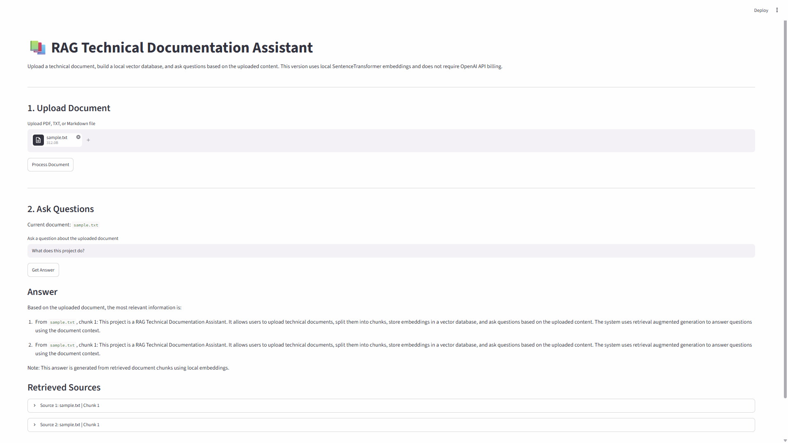

# RAG Technical Documentation Assistant

A **local, retrieval-only (RAG-style)** technical documentation assistant. Upload PDF, TXT, or Markdown files, index them with local embeddings, retrieve document-grounded excerpts, and inspect the sources and their cosine-similarity scores. **This version does not use a generative LLM.**

This portfolio project demonstrates semantic retrieval, per-document isolation, safe upload handling, relevance-based abstention, and testable source attribution. It is a retrieval foundation for a future generative RAG pipeline.

---

## Project Overview

Technical documents, README files, manuals, and project documentation can become long and difficult to search manually.

This project solves that problem by building a simple local documentation assistant.

The user can:

- Upload a PDF, TXT, or Markdown file
- Process the document into smaller chunks
- Generate local embeddings for each chunk
- Store the chunks inside a Chroma vector database
- Ask questions about the uploaded document
- Retrieve the most relevant chunks
- Display source-grounded excerpts (not an LLM-written answer)
- View retrieved sources, chunk IDs, and cosine similarity
- Search only the active uploaded document
- Abstain when no candidate exceeds the configured relevance threshold

This version does not require OpenAI API billing. It uses the local `sentence-transformers/all-MiniLM-L6-v2` embedding model and returns retrieved excerpts rather than generating new text.

---

## What is RAG?

RAG stands for Retrieval-Augmented Generation.

In a **full** RAG system, the retriever finds document context and an LLM generates an answer grounded in that context. **This project implements the retrieval and source-display stages only**; it has no LLM generation stage.

Basic RAG workflow:

```text
User Document
   ↓
Document Loading
   ↓
Text Chunking
   ↓
Embedding Generation
   ↓
Vector Database Storage
   ↓
User Question
   ↓
Semantic Search / Retrieval
   ↓
Cosine Similarity Filter (threshold: 0.35)
   ↓
Extractive Excerpts + Source References (or Abstention)
```

---

## Project Features

- PDF, TXT, and Markdown document upload
- Document loading with LangChain document loaders
- Text chunking with RecursiveCharacterTextSplitter
- Local embedding generation using SentenceTransformers
- Chroma vector database with a **separate collection per processed document**
- Retrieval limited to the **active document** in the Streamlit session
- Relevance filtering using cosine similarity (default threshold `0.35`)
- Extractive excerpts or an explicit insufficient-evidence response
- Source display with file name, chunk ID, similarity score, and PDF page when available
- Upload validation: PDF/TXT/MD only, 20 MB maximum, collision-resistant filenames
- Streamlit user interface
- Ten lightweight automated unit tests
- No OpenAI API billing required for the local version

---

## App Preview

The Streamlit interface allows users to upload a technical document, process it into chunks, build a local vector database, ask questions, and view retrieved sources.



---

## Project Structure

```text
rag-documentation-assistant/
│
├── app/
│   └── streamlit_app.py
│
├── data/
│   ├── documents/
│   └── vectorstore/
│
├── screenshots/
│   └── rag_app_demo.png
│
├── src/
│   ├── __init__.py
│   ├── config.py
│   ├── document_loader.py
│   ├── document_scope.py
│   ├── text_splitter.py
│   ├── vector_store.py
│   └── rag_chain.py
│
├── examples/
│   ├── python_demo.txt
│   └── sql_demo.txt
│
├── tests/
│   ├── test_document_scoping.py
│   └── test_upload_safety.py
│
├── .env.example
├── .gitignore
├── main.py
├── README.md
└── requirements.txt
```

---

## Architecture

```text
Uploaded Document
       ↓
document_loader.py
       ↓
text_splitter.py
       ↓
vector_store.py
       ↓
Document-Scoped Chroma Collection
       ↓
User Question
       ↓
Retrieve Candidates from Active Collection
       ↓
Compute Cosine Similarities + Apply Threshold
       ↓
rag_chain.py
       ↓
Relevant Excerpts + Sources, or Abstention
       ↓
Streamlit UI
```

---

## Technologies Used

- Python
- Streamlit
- LangChain Core / Text Splitters
- LangChain Community (document loaders; legacy dependency)
- LangChain Chroma
- LangChain HuggingFace
- ChromaDB
- SentenceTransformers
- HuggingFace Transformers
- PyPDF
- Python-dotenv
- Git
- GitHub

---

## Local Embeddings

This project uses the following local embedding model:

```text
sentence-transformers/all-MiniLM-L6-v2
```

The embedding model converts each document chunk into a numerical vector.

Similar meanings are placed close to each other in vector space. This allows the system to retrieve relevant document chunks even when the user's question does not use the exact same words as the document.

Example:

```text
Question: How do I run the project?
Relevant text: Use streamlit run app/streamlit_app.py
```

Even though the words are different, semantic retrieval can still find the relevant chunk.

---

## How It Works

### 1. Document Upload

Users upload a document through the Streamlit interface. Uploaded file names are sanitized for display, and storage filenames are randomized to prevent overwriting. The upload limit is 20 MB per file.

Supported file types:

```text
.pdf
.txt
.md
```

---

### 2. Document Loading

The project uses LangChain document loaders:

- `PyPDFLoader` for PDF files
- `TextLoader` for TXT and Markdown files

Each loaded document is stored with metadata such as:

```text
source
chunk_id
document_id
page (when provided by the PDF loader)
```

---

### 3. Text Chunking

Documents are split into smaller chunks using:

```text
RecursiveCharacterTextSplitter
```

Default chunk configuration:

```text
CHUNK_SIZE = 1000
CHUNK_OVERLAP = 150
```

Chunking is important because long documents cannot be efficiently searched or passed into a retrieval system as one large block.

---

### 4. Vector Store Creation

Each chunk is embedded using local SentenceTransformer embeddings.

The chunks and their embeddings are stored in ChromaDB. **Every processed upload receives a new document ID and its own collection** (`doc_<32-character-uuid-hex>`). Retrieval requires this ID, so the current document cannot accidentally search a shared collection.

The vector database is saved locally under:

```text
data/vectorstore/
```

This folder is excluded from GitHub using `.gitignore`. Saved collections remain on disk until explicitly cleaned up; this demo does not automatically delete old collections.

---

### 5. Semantic Retrieval

When the user asks a question, the system retrieves the most relevant chunks using semantic similarity.

Default retrieval setting:

```text
RETRIEVAL_K = 4
```

This asks Chroma for up to four candidate chunks from the active document. The application then recomputes cosine similarity using the local embedding model and **keeps only candidates with similarity >= `MIN_RELEVANCE_SCORE` (default `0.35`)**. The cutoff is a heuristic, **not a confidence probability**; it can reject relevant text or accept unrelated text and should be calibrated with labelled examples.

---

### 6. Extractive Results and Abstention

This version **does not generate** an LLM answer. It displays up to three relevant retrieved excerpts and their sources. When no candidate clears the threshold, it states that the active document does not contain sufficiently relevant information.

The answer includes:

- The most relevant retrieved information
- Source file name
- Chunk ID
- Cosine similarity score and PDF page when available
- Retrieved source previews

Example output:

```text
Based on the uploaded document, the most relevant information is:

From sample.txt, chunk 1:
This project is a RAG Technical Documentation Assistant...
```

---

## Example Usage

Example document content:

```text
This project is a RAG Technical Documentation Assistant.
It allows users to upload technical documents, split them into chunks, store embeddings in a vector database, and ask questions based on the uploaded content.
The system retrieves document excerpts using local embeddings and does not generate a new answer with an LLM.
```

Example question:

```text
What does this project do?
```

Example answer:

```text
Based on the uploaded document, the most relevant information is:

From sample.txt, chunk 1:
This project is a RAG Technical Documentation Assistant. It allows users to upload technical documents, split them into chunks, store embeddings in a vector database, and ask questions based on the uploaded content.
```

---

## How to Run Locally

### 1. Clone the repository

```bash
git clone https://github.com/Zahra-ziaee/rag-documentation-assistant.git
cd rag-documentation-assistant
```

### 2. Create and activate virtual environment

Recommended: Python 3.12 (64-bit) on Windows. Create a dedicated virtual environment.

Windows CMD:

```cmd
py -3.12 -m venv .venv
.venv\Scripts\activate.bat
```

Or, for PowerShell:

```powershell
py -3.12 -m venv .venv
.venv\Scripts\Activate.ps1
```

If you have a compatible Python 3.12 executable on PATH but not the `py` launcher, use `python -m venv .venv`.

### 3. Install dependencies

```cmd
.venv\Scripts\python.exe -m pip install --upgrade pip
.venv\Scripts\python.exe -m pip install -r requirements.txt
.venv\Scripts\python.exe -m pip check
```

`requirements.txt` lists the primary dependencies at versions used during this development. Pip resolves their transitive dependencies. `torch` and matching `torchvision` versions are pinned to avoid the Transformers image-processing import error seen during setup. The PyTorch installation can be large; initial model download also requires internet. A successful `pip check` does not replace running the application tests.

### 4. Run the Streamlit app

Recommended command:

```cmd
.venv\Scripts\python.exe -m streamlit run app/streamlit_app.py --server.fileWatcherType none
```

The `--server.fileWatcherType none` option helps avoid unnecessary Streamlit watcher warnings caused by some Transformer-related modules.

---

## Running with a Test File

The repository includes `examples/python_demo.txt` and `examples/sql_demo.txt` for quick manual checks. You can also create a new test file:

```bash
New-Item sample.txt -ItemType File -Force
```

Add this content:

```text
This project is a RAG Technical Documentation Assistant.
It allows users to upload technical documents, split them into chunks, store embeddings in a vector database, and ask questions based on the uploaded content.
The system retrieves document excerpts using local embeddings and does not generate a new answer with an LLM.
```

Then:

1. Open the Streamlit app
2. Upload `sample.txt`
3. Click `Process Document`
4. Ask:

```text
What does this project do?
```

---

## Tests and Validation

Run unit tests from the repository root:

```cmd
.venv\Scripts\python.exe -m unittest discover -s tests -p "test_*.py" -v
```

Expected (for this implementation): **10 tests**, covering document-ID validation, cross-document isolation, cosine similarity behavior, related/unrelated question handling, empty inputs, safe paths, size/type restrictions and duplicate upload names. These tests use lightweight mock objects for Chroma and embeddings; they are **not** end-to-end model integration tests.

The following two-document manual smoke test was performed using the real Streamlit app and the local embedding model:

| Active document | Question | Observed result |
|---|---|---|
| `python_demo.txt` | `How is a Python function defined?` | Excerpts sourced from the Python file |
| `sql_demo.txt` | `What does JOIN do?` | SQL source returned; cosine similarity **0.43** |
| `sql_demo.txt` | `What causes earthquakes?` | Abstained; no sources passed **0.35** |

These observations demonstrate the tested examples, not universal correctness or calibrated confidence. The same threshold should be checked with a larger labelled question set before production use.

## Document Scope and Safety Notes

- Every *processed upload* gets a new random document ID and a separate Chroma collection; the Streamlit session keeps track of the **current** document ID.
- Files with the same original name are saved under separate generated filenames, and only `.pdf`, `.txt`, `.md` up to 20 MB are accepted.
- The app is a **local demo**, not a secure multi-tenant service. A separate collection by itself is not authentication or access control.
- `data/documents/` and `data/vectorstore/` are local private artifacts and should remain Git-ignored. Processing new uploads does not delete old persisted data.

---

## Git Ignore Policy

The following are excluded from GitHub:

```text
.venv/
.env
data/documents/
data/vectorstore/
__pycache__/
*.pyc
```

This prevents local environment files, uploaded documents, API keys, and vector database files from being committed.

---

## Environment Variables

This project includes:

```text
.env.example
```

The `.env.example` file is a template for future environment variables.

The actual `.env` file should not be committed to GitHub.

Current local version does not read an OpenAI API key. A future LLM-based version could use:

```text
OPENAI_API_KEY=your_openai_api_key_here
```

---

## Current Status

Completed:

- Project structure
- Streamlit interface
- Document upload
- PDF/TXT/Markdown support
- Document loading
- Text chunking
- Local embedding generation
- Chroma vector store
- Semantic retrieval restricted to the currently active document
- Isolated per-document Chroma collections
- Heuristic cosine-similarity filtering and abstention (`0.35` default)
- Safe upload validation and collision-resistant storage names
- Extractive excerpt display (not generative LLM responses)
- Source display with similarity scores and optional PDF page numbers
- 10 automated tests (mocked unit tests) and manual Python/SQL checks
- Local no-cost execution
- App screenshot in README

---

## Limitations

This version does not use an LLM for natural language answer generation.

Instead, it returns document excerpts based on retrieval and the relevance threshold.

This design was chosen to avoid API billing and make the project fully runnable locally.

Current limitations:

- No LLM-based summarization
- Only one active document can be searched at a time (no multi-document question answering)
- No authentication or persistent user-level access control
- Saved per-document collections are not automatically cleaned up
- Relevance threshold is heuristic; false positives and false negatives are possible
- Unit tests mock Chroma and embeddings; there is no clean-install CI or full integration test yet
- `langchain-community` is a legacy/sunset dependency; its document loaders should eventually be migrated
- No advanced reranking
- No LangGraph workflow yet
- No FastAPI backend yet
- No deployment setup

---

## Future Improvements

Planned improvements:

- Add optional OpenAI or local LLM generation
- Add LangGraph workflow
- Add multi-document support
- Add conversation memory
- Add source ranking and retrieval evaluation
- Improve PDF page-level citations and chunk selection
- Add FastAPI backend
- Add Docker support
- Add evaluation metrics for retrieval quality
- Add deployment instructions

---

## Key Takeaways

```text
RAG Technical Documentation Assistant | Python, Streamlit, LangChain, ChromaDB, SentenceTransformers

- Built a local retrieval-only, RAG-style documentation assistant for PDF, TXT and Markdown files.
- Isolated each processed document in its own Chroma collection and guarded against cross-document source leakage.
- Added heuristic cosine-similarity filtering with explicit abstention on unsupported queries.
- Added validated uploads, collision-resistant filenames, source attribution and 10 unit tests.
- Used SentenceTransformer embeddings to enable local document search without OpenAI API billing.
```

---

## Author

Zahra Ziaee

Focus: Machine Learning, Data Science, Recommender Systems, MLOps, Forecasting, and Applied AI Systems
